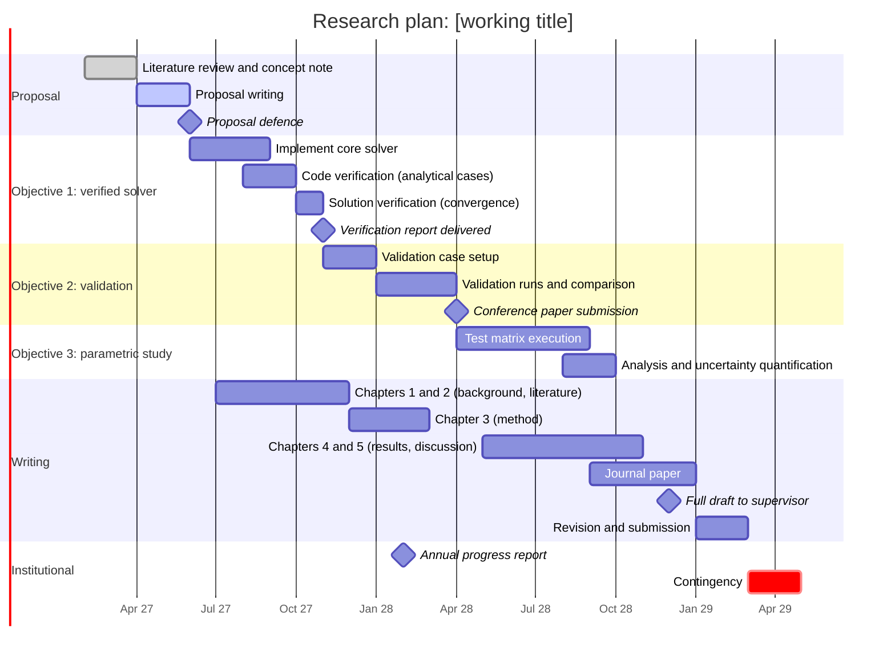

# Gantt chart template

Mermaid renders natively on GitHub. Replace the dates and tasks. One section per objective; writing runs in parallel; include fixed institutional dates.

Do not use a colon in a task name. Mermaid splits each task line at the first colon, so `Deliverable: report :milestone, ...` is a syntax error. Colons are fine in the chart title and in section names.

## Typical durations

| Phase | MEng (2 years) | PhD (3 to 4 years) |
|---|---|---|
| Proposal | 3 to 4 months | 4 to 6 months |
| Method development and verification | 5 to 6 months | 9 to 12 months |
| Validation and main study | 6 to 8 months | 12 to 18 months |
| Writing (overlapping) | from month 6 | from month 9 |
| Contingency | 2 months | 3 to 4 months |

Check your Department's minimum and maximum registration periods and the examination submission windows; they fix the end date, so plan backwards from it.
